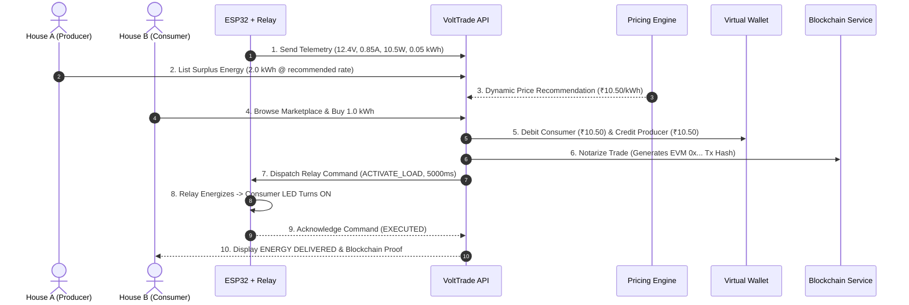

# VoltTrade System Architecture

VoltTrade is a peer-to-peer renewable energy trading platform uniting physical IoT smart meters (ESP32 + INA219 + OLED + Relay) with a web marketplace, AI dynamic pricing engine, virtual double-entry wallet, and blockchain transaction verification.

---

## 1. High-Level Architecture Diagram

```mermaid
graph TD
    subgraph "Physical Hardware Layer"
        Solar["Mini Solar Panel / DC Source"] --> INA["INA219 Sensor (V, I, P)"]
        INA --> ESP["ESP32 Microcontroller"]
        ESP --> OLED["0.96\" SSD1306 OLED"]
        ESP --> Relay["5V Relay Module"]
        Relay --> LED["Consumer Load LED"]
    end

    subgraph "Communication & Ingestion"
        ESP -->|"HTTP POST /api/devices/telemetry"| Ingest["REST Ingestion Layer"]
        Ingest -->|"HTTP GET /api/devices/:id/commands/pending"| ESP
    end

    subgraph "Backend Services (Modular Node.js / Express)"
        Ingest --> DevSvc["Device Management Service"]
        Ingest --> EnergySvc["Energy Monitoring Service"]
        EnergySvc --> PriceSvc["Dynamic AI Pricing Engine"]
        EnergySvc --> MatchEngine["Matching Engine"]
        MatchEngine --> TradeSvc["Trade Lifecycle Coordinator"]
        TradeSvc --> WalletSvc["Virtual Ledger & Wallet Service"]
        TradeSvc --> BlockSvc["Blockchain Service (Mock / EVM)"]
        TradeSvc --> NotifSvc["In-App Notification Service"]
        TradeSvc --> DevSvc
    end

    subgraph "Storage Layer"
        DevSvc --> DB[(Prisma SQLite / Postgres)]
        EnergySvc --> DB
        TradeSvc --> DB
        WalletSvc --> DB
    end

    subgraph "Web Frontend (Next.js App Router)"
        Dashboard["Main Dashboard (/dashboard)"] <--> BackendAPI["API Server (:4000)"]
        Market["Marketplace (/marketplace)"] <--> BackendAPI
        TradeView["Trade Explorer (/trades/[id])"] <--> BackendAPI
        WalletUI["Virtual Wallet (/wallet)"] <--> BackendAPI
        Analytics["Energy Analytics (/energy)"] <--> BackendAPI
        Admin["Admin & Hardware Control (/admin)"] <--> BackendAPI
    end
```

---

## 2. End-to-End P2P Trade Lifecycle



---

## 3. Modularity & Decoupling

- **Hardware Agnostic**: Backend communicates via JSON REST telemetry. If the hardware is disconnected, the system clearly flags **OFFLINE** and allows safe demo simulation without crashing.
- **Blockchain Abstraction**: The `BlockchainService` interface hides blockchain implementation details. Switching from `MockBlockchainService` to Polygon, Ethereum, or Solana requires zero changes to matching or trade logic.
- **Pluggable Pricing Engine**: The deterministic heuristic model can be substituted with an ONNX/PyTorch machine learning inference service by matching the `PricingRecommendation` interface.
- **Database Scalability**: Prisma schema uses UUID/CUID and standard relational tables, enabling seamless migration from SQLite to PostgreSQL/CockroachDB.
